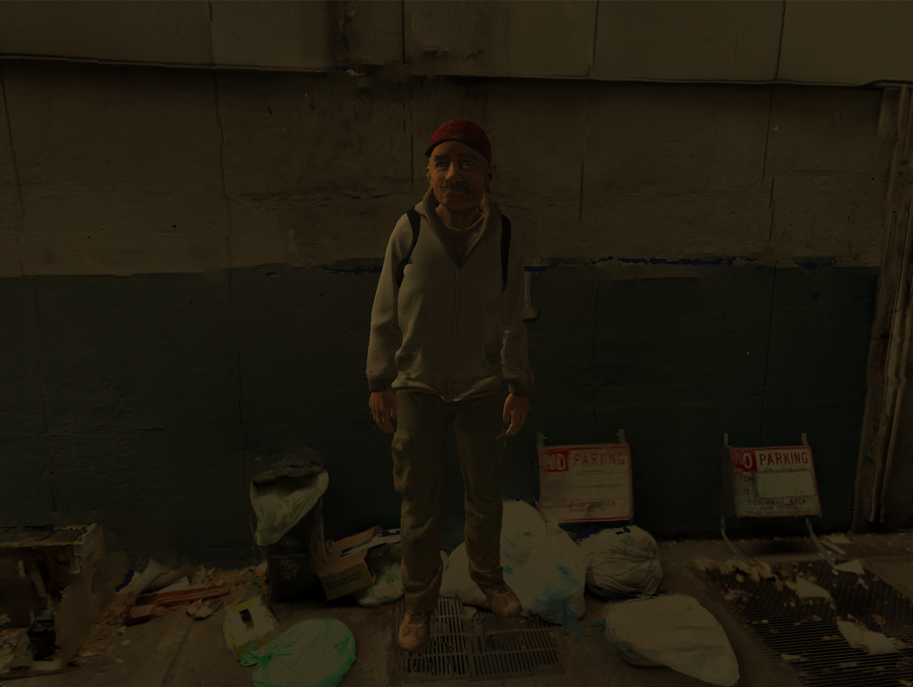

# CG Assignment 2

A small real-time 3D scene built with C++17 and modern OpenGL (3.3 core) for a Computer Graphics assignment. A textured character stands in a grimy alley, lit by a single bare yellow bulb using Phong lighting (ambient + diffuse + specular, with distance attenuation).



## Features

- OBJ model loading (background, character, light-marker cube)
- Texture mapping with mipmaps (via `stb_image`)
- Phong point light with attenuation
- Free-look first-person camera

## Controls

| Input | Action |
| --- | --- |
| `W` `A` `S` `D` | Move camera |
| Mouse | Look around |
| `Esc` | Quit |

## Build & Run

Requires CMake 3.20+, a C++17 compiler and [vcpkg](https://github.com/microsoft/vcpkg) (installed at `$HOME/vcpkg` or pointed to by `VCPKG_ROOT`). Dependencies (GLFW, GLEW, GLM, stb) are installed automatically from `vcpkg.json`.

```sh
cmake --preset mac-arm64        # or win-msvc-2022 / win-msvc-2026 / mac-intel
cmake --build build/mac-arm64
./build/mac-arm64/OpenGLStarter
```

## Project Layout

```
src/        main.cpp and helper classes (Mesh, Shader, Window)
Shaders/    GLSL vertex/fragment shaders
Models/     .obj meshes
Textures/   image textures
docs/       screenshots
```
